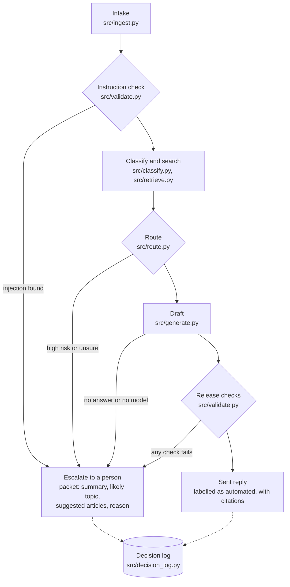

# Architecture

How one ticket moves through the system, what each component does, and why it is built that way.
Figures quoted here come from `evaluation/validation_run/metrics.md` (the 80-ticket validation run) or the
out-of-fold scripts named beside them (500 development tickets).

## Ticket flow

Every ticket ends in exactly one of two places: a sent reply, or a person's queue with a packet that saves
them the search. Every decision on either path is written to the SQLite decision log with its reason and
requirement IDs.

## Components

| Step | File | What it does |
|---|---|---|
| Intake | `src/ingest.py` | Normalises email, chat, docs comments and forum posts into one `Ticket`. Never raises; keeps the raw record. |
| Instruction check | `src/validate.py` (`find_injection`) | Blocks tickets that try to instruct the system, before routing, whatever routing would decide. |
| Search | `src/retrieve.py` | Section-level chunks of the help articles in Chroma, MiniLM embeddings, cosine score, minimum 0.40. |
| Classify | `src/classify.py` | Logistic regression on embeddings: topic (intent), urgency, and the probability a ticket is safe to answer automatically (Platt-calibrated). Trained at start-up on the development tickets; local, so it works when the model provider is down. |
| Route | `src/route.py` | Deterministic rules in order: kill switch, must-escalate topics (security incident, compliance, feature request, unclear request, data residency), topic-confidence floor 0.50, answer-probability threshold 0.85. |
| Draft | `src/generate.py`, `prompts/PR-01_answer.txt` | A language model answers only from the retrieved passages, in strict JSON, every sentence citing a passage ID. Invalid JSON or unknown citations fail the draft. |
| Release checks | `src/validate.py`, `prompts/PR-02_grounding.txt` | Private data, commitments (refunds, credits, dates), relevance, and an independent grounding check per sentence. If the grounding check cannot run, the reply is blocked (fails closed). |
| Escalation packet | `src/route.py` (`escalation_packet`) | Summary, likely topic, suggested articles (from a topic-expanded search) and the reason it came to a person. |
| Decision log | `src/decision_log.py` | One SQLite row per automated decision: input summary, model and version, prediction, alternatives, sources, threshold, action, reason, guardrail results, requirement IDs. |
| Model client | `src/llm.py` | Groq models first, OpenRouter as fallback; skips busy models, waits on retry-after up to 60 s, remembers daily caps and rejected keys, caches responses on disk. With no working key every would-be answer escalates. |
| Harness | `evaluation/harness.py`, `evaluation/metrics.py` | Runs a ticket file unattended; one failing ticket escalates and the run continues. Writes results, decision log and metrics. |

## Design choices and the alternatives

- **A classifier, not the language model, decides routing.** It is deterministic, calibrated, fast, and keeps
  routing alive during provider outages. Grouped cross-validation (no message text shared between folds) was
  needed because the data is templated: ordinary cross-validation reported 100% topic accuracy, grouped gave 95%.
- **Plain search for drafting, topic-expanded search for agents.** Adding the predicted topic's article title to
  the query found the right article more often for non-fluent writers (88.5% to 96.6%), but drafting from it
  released fewer answers (28 vs 34 on 48 paired tickets, `evaluation/passage_compare.py`) and feeding it to the
  routing model worsened calibration. So it is used only for what the agent sees.
- **Fail closed.** A grounding check that cannot run blocks the reply. This costs automation (2 of 5 blocks in the
  validation run) and is deliberate.
- **Kill switch as a file** (`storage/AUTOMATION_OFF`), checked at routing and again just before sending, so
  support leads can stop automation with no deployment.
- **Free model tiers with fallbacks** rather than one paid model: the brief required no spend, and outages and
  daily caps were routine during the build.

## Known limits

- Automation is 16% of validation tickets against a 65% target (the PRD revision re-scoped it).
- Citation accuracy on sent replies is 78.7% against 95%.
- p95 processing time depends on provider load (62 s in the validation run, from rate-limit waits).
- A routing-accuracy gap for European customers on the development set (p = 0.026) has no identified cause.
- Urgency prediction is 42.5%: identical texts carry different urgency labels in the data.
